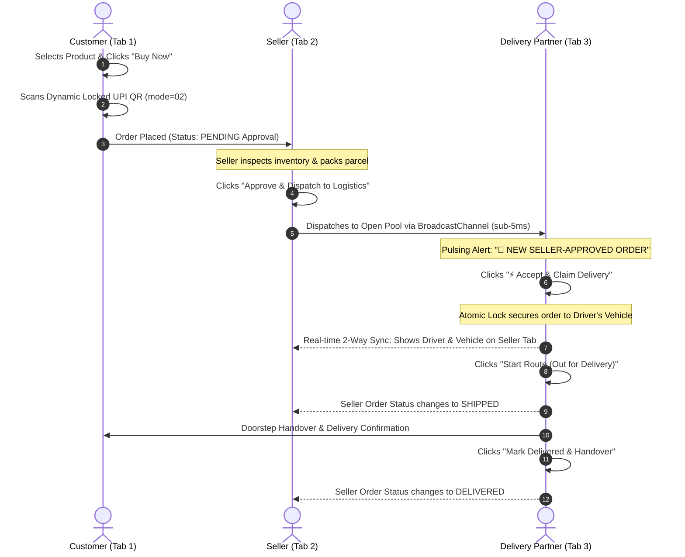
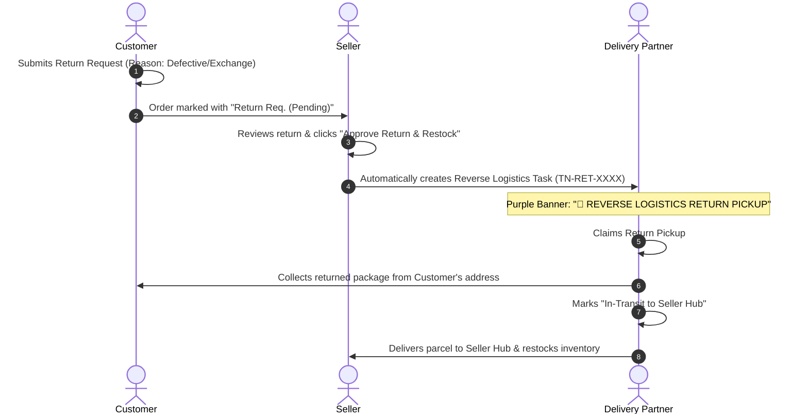

# TRADENEST 🚀

> **AI‑Powered, Multi-Tenant Cloud‑Native Digital Marketplace & Logistics Platform**  
> Production‑grade, microservices architecture, GitOps‑ready – built with **React 18, Node 20, PostgreSQL, Redis, and Real-Time Event-Driven Dispatches**.

[](https://github.com/your-org/tradenest/actions/workflows/ci.yml)
[](https://github.com/your-org/tradenest/actions/workflows/cd-staging.yml)
[](https://github.com/your-org/tradenest/actions/workflows/cd-production.yml)
[](LICENSE)
[](tests/)

---

## 🌟 Platform Highlights

| Domain | Architecture & Technologies |
| :--- | :--- |
| **Frontend** | React 18, Vite, Tailwind CSS, Redux Toolkit, Framer Motion, Lucide Icons, Dark Mode |
| **Multi-Role Isolation** | **4-Role Session Partitioning**: Customer, Seller, Admin, and Delivery Partner operate simultaneously across browser tabs without clobbering each other |
| **Logistics & Fleet Portal** | Dedicated Delivery Partner Portal (`/logistics/dashboard`), Runsheet routing, Google Maps navigation, Driver Shift Toggles |
| **Atomic Claim Lock** | First-come, first-claimed distributed locking on open pool orders preventing duplicate pickup conflicts between multiple active drivers |
| **3-Tier Fulfillment Pipeline** | **Customer Order** $\rightarrow$ **Seller Approval & Packing** $\rightarrow$ **Logistics Driver Pickup & Doorstep Handover** |
| **Reverse Logistics** | Full product return pipeline: Customer Return Request $\rightarrow$ Seller Approval $\rightarrow$ Reverse Logistics Driver Pickup Task $\rightarrow$ Hub Restock |
| **Reseller Platform** | Wholesale margin markup (e.g. ₹700 wholesale $\rightarrow$ sell for ₹950); custom end-customer invoice generation with platform cost hidden |
| **Dynamic UPI Payments** | Tamper-proof UPI QR (`am=${amount}&mode=02`) with locked exact order amount for GPay, PhonePe, and Paytm |
| **AI Experience** | Instant prefix category autocomplete ("Search half, get full word"), AI similar product recommendation carousels |
| **Customer Rewards** | 5% instant wallet cashback + 10% next-order promo coupons (`REWARD10`) issued on order completion |
| **Backend Services** | 6 Node 20 microservices (Auth, Catalog, Order, Payment, AI, Notification) + API Gateway |
| **Databases & Cache** | PostgreSQL (Prisma ORM Multi-AZ), Redis (ElastiCache session & rate-limiting), MinIO image bucket |
| **Security & Auth** | JWT RS256, rotating refresh tokens, deterministic SHA-256 password reset, RBAC route guards |

---

## 🔄 End-to-End Lifecycles

### 1. The 3-Tier Order-to-Delivery Pipeline



---

### 2. Reverse Logistics / Product Return Pipeline



---

## 👥 Demo & Test Accounts

The platform comes pre-seeded with isolated credentials for all 4 roles:

| Role | Portal URL | Email | Password | Purpose |
| :--- | :--- | :--- | :--- | :--- |
| **Customer** | `/` | `customer@tradenest.local` | `Customer@123` | Storefront browsing, Buy Now, UPI payments, Rewards & Wallet |
| **Seller** | `/seller/orders` | `seller@tradenest.local` | `Seller@123` | Inventory management, Order approval, Return verification |
| **Logistics Fleet** | `/logistics/dashboard` | `delivery@tradenest.local` | `Delivery@123` | Driver portal, runsheets, atomic claims, doorstep delivery |
| **Admin** | `/admin/dashboard` | `admin@tradenest.local` | `Admin@123` | User directory, assigning delivery partner logins, approvals |
| **Super-Admin** | `/admin/dashboard` | `superadmin@tradenest.local` | `SuperAdmin@123` | Platform oversight & system configuration |

> [!NOTE]  
> **Multi-Tab Multi-Role Isolation**: You can open all 4 portals in 4 separate tabs on the same browser simultaneously. Tab refreshes will never overwrite or log out neighboring roles.

---

## 🛠️ Key Feature Reference

### 🚚 Logistics Fleet & Atomic Claim Locks
- **Unclaimed Pool**: Newly approved orders enter the fleet pool with `claimedBy: null`.
- **Atomic Locking**: When a driver clicks `⚡ Accept & Claim Delivery`, the order is locked to their vehicle ID.
- **Race Condition Prevention**: If a second driver clicks accept simultaneously, the system detects the lock and immediately alerts: *"⚠️ Too late! Order was already claimed by [Driver Name] ([Vehicle])"*.
- **Live 2-Way Sync**: Driver claims and status transitions (`Out for Delivery`, `Delivered`) automatically reflect in real time on the Seller's dashboard with driver badges.

### 🔄 Reverse Logistics (Returns)
- When a seller approves a customer's return request, TRADENEST automatically dispatches a **Reverse Logistics Task** (`TN-RET-XXXX`) to the Logistics Fleet.
- Drivers collect the package from the customer's address and return it to the designated Seller Hub for restock.

### 💼 Reseller Mode & Custom Customer Invoices
- Resellers can specify custom markup prices on any catalog item (e.g. wholesale base ₹700 $\rightarrow$ resale ₹950).
- TRADENEST generates a customer-facing invoice showing strictly the **₹950** price and customer delivery address.
- The platform base wholesale price is concealed from the end customer and driver run sheets.
- Reseller margin (₹250) is credited directly to the reseller's TRADENEST Wallet.

### 💳 Dynamic Locked UPI QR Code
- UPI payment generation automatically builds locked intent strings (`am=${total}&cu=INR&mode=02&pa=...`).
- When scanned with GPay, PhonePe, or Paytm, the exact order amount is locked and cannot be manually edited by the customer.

### 🧠 AI Search & Recommendation Intelligence
- **Prefix Expansion ("Search half, get full word")**: Typing prefixes such as `smartp` auto-suggests category `Smartphones` and matching products.
- **Similar Product Recommendations**: Product detail pages feature category-matched AI recommendations.

### 🎁 Purchase Rewards & Multi-Step Wallet
- **Cashback**: Every completed order earns 5% instant cashback deposited into the customer's TRADENEST Wallet.
- **Next-Order Coupon**: Customers receive a 10% discount promo coupon (`REWARD10`) post-checkout.
- **Structured Wallet Top-Up**: 3-step structured funding flow (Amount selection $\rightarrow$ Method $\rightarrow$ Instant verification).

---

## 🚀 Quick Start (Local Setup)

### 1. Prerequisites
- Node.js 20+
- Docker & Docker Compose
- npm 10+

### 2. Installation & Database Setup
```bash
# Clone the repository
git clone https://github.com/your-org/tradenest.git
cd tradenest

# Install dependencies across all workspaces
npm ci

# Start database and cache services (PostgreSQL, Redis, MinIO)
docker compose up -d postgres redis minio

# Push database schema & seed initial accounts
npm run db:push
npm run db:seed
```

### 3. Running Services
```bash
# Terminal 1: Run all backend microservices
npm run dev:backend

# Terminal 2: Run frontend development server
npm run dev:frontend
```

The application is now accessible at:
- **Frontend App**: `http://localhost:3000`
- **API Gateway**: `http://localhost:4000`
- **Auth Microservice**: `http://localhost:4001`
- **Catalog Microservice**: `http://localhost:4002`
- **Order Microservice**: `http://localhost:4003`
- **Payment Microservice**: `http://localhost:4004`
- **Notification Microservice**: `http://localhost:4005`
- **AI Microservice**: `http://localhost:4006`

---

## 🧪 Automated Testing

TRADENEST features a comprehensive unit and integration test suite:

```bash
# Run unit tests across all test suites
npm --workspace tradenest-frontend run test:unit

# Build frontend production bundle
npm --workspace tradenest-frontend run build
```

### Verified Test Suites:
```text
✓ src/features/cart/cartSlice.test.ts          (6 tests)
✓ src/features/auth/authSlice.test.ts          (8 tests)
✓ src/features/verification.test.ts           (18 tests)
  1. Multi-Tab Multi-Role Isolation (All 4 roles)
  2. Forgot Password SHA-256 Token Verification
  3. UPI QR Exact & Locked Amount (mode=02)
  4. Reseller Order Pricing & Customer Bill Logic
  5. Purchase Rewards & Cashback Calculation
  6. Discount Badge & Savings Calculation
  7. AI Search Autocomplete Prefix Matching
  8. Logistics Real-time Order Notification & Address Transmission
  9. Admin-Assigned Delivery Partner Authentication & Isolated Session
 10. Delivery Partner Atomic Claim Lock & Conflict Prevention
 11. Seller Approval Pipeline & Logistics Dispatch Trigger
 12. Two-Way Logistics-to-Seller Real-Time Sync & Reverse Logistics Returns

Test Files:  3 passed (3)
Tests:       32 passed (32)
```

---

## 📂 Repository Structure

```text
tradenest/
├── apps/
│   ├── frontend/               # React 18 SPA (Vite + Tailwind + Redux Toolkit)
│   │   └── src/
│   │       ├── components/     # Layouts (Admin, Seller, Logistics, Storefront)
│   │       └── features/       # Modular features (auth, catalog, cart, checkout, seller, logistics, admin)
│   └── backend/                # Microservices
│       ├── auth/               # JWT RS256 authentication & password recovery
│       ├── catalog/            # Products, categories, search, recommendations
│       ├── order/              # Orders, returns, and inventory lifecycle
│       ├── payment/            # Razorpay, Stripe, UPI, Wallet services
│       ├── notification/       # Email & SMS notification handlers
│       ├── ai/                 # Search autocomplete & recommendation algorithms
│       └── gateway/            # Reverse proxy & request router
├── libs/                       # Shared TypeScript libraries
├── infra/                      # Terraform, Helm, ArgoCD, Monitoring configs
└── docker-compose.yml          # Container configuration
```

---

## 📜 License

MIT © 2026 TRADENEST Platform. Built for production-grade e-commerce and logistics engineering.
